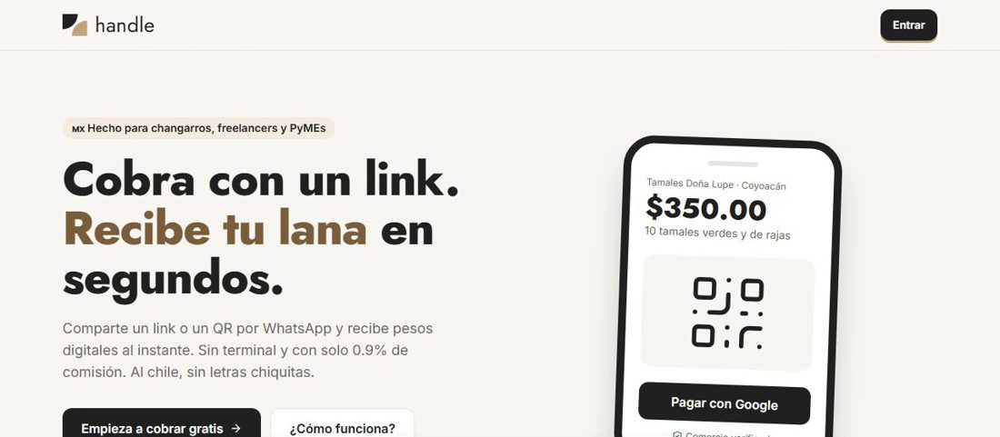
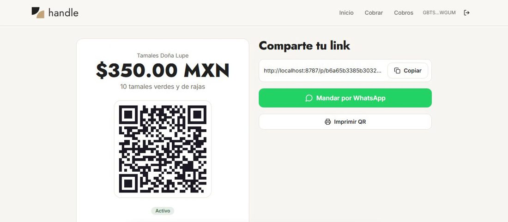
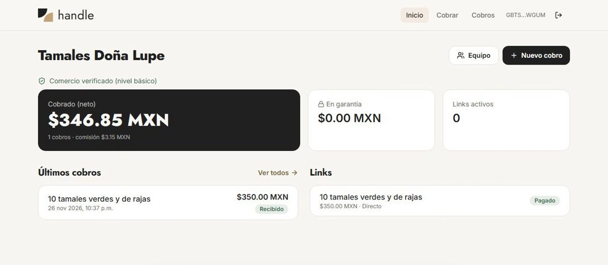

<p align="center"></p>

# Hand Peys

> **Cobra con un link. Recibe pesos digitales en segundos. Sin terminal y por 0.9%.**

Hand Peys es una plataforma de **links y QR de cobro** para changarros, freelancers y PyMEs en México. El comercio escribe el monto, comparte el link por WhatsApp y su cliente paga en segundos con **pesos digitales (MXNe)** o **dólares digitales (USDC)** sobre la red **Stellar**. Las reglas de cobro viven en contratos **Soroban**: verificación de identidad on-chain, comisión de 0.9% y pagos con garantía.

Una terminal tradicional cobra alrededor de 3.5% + IVA y deposita en días. Con Hand Peys el comercio paga **0.9%** y recibe el dinero en el momento.

Hecho para **[Ship It: Builder Challenge](https://www.thebafnetwork.com/hackathons/mx/ship-it)** de BAF × Stellar México (23–27 nov 2026).

| | |
|---|---|
| 🎬 **Demo en video** | [Ver demo con Ship It (94 s)](https://github.com/DonCervantes/hand-peys/releases/download/v1.0.0/handle-demo-shipit.webm) · [Demo corta (82 s)](https://github.com/DonCervantes/hand-peys/releases/download/v1.0.0/handle-demo.webm) · [Release v1.0.0](https://github.com/DonCervantes/hand-peys/releases/tag/v1.0.0) |
| 🌐 **App en vivo (testnet)** | **https://hand-peys.cruzcervantesdanieladrianelias.workers.dev** |
| 📜 **Contratos (testnet)** | [`docs/TESTNET.md`](docs/TESTNET.md): IDs, funciones y transacciones reales |
| 📌 **Estado y pendientes** | [`docs/ESTADO.md`](docs/ESTADO.md) |

<p align="center">
  
  
  
</p>

## Cómo se usa

### Si vendes (comercio)

1. **Entra** en la [app](https://hand-peys.cruzcervantesdanieladrianelias.workers.dev) con tu **nombre y correo**. Se crea una wallet para ti en el navegador: sin frases semilla.
2. **Registra tu negocio**: nombre, tipo (changarro, freelance o PyME) y ciudad.
3. **Verifica tu identidad una sola vez**: foto de tu INE y una selfie. En testnet puedes usar las imágenes de ejemplo. On-chain solo queda que estás verificado, nunca tus datos.
4. **Habilita pesos y dólares** en tu wallet con un clic (es la *trustline* de Stellar; cuesta una fracción de centavo).
5. **Crea un cobro**: monto, concepto y modo, **directo** o **con garantía**.
6. **Compártelo**: link, botón de WhatsApp o QR para imprimir.
7. **Mira tus cobros** en el panel: neto recibido, comisión, dinero en garantía y links activos. Puedes invitar **cajeros** con un link de un solo uso.

### Si pagas (cliente)

1. Abre el link o escanea el QR.
2. Entra con tu nombre y correo, y habilita pesos en tu wallet.
3. En testnet, pulsa **"Obtener pesos de prueba"** para recibir MXNe de prueba.
4. Pulsa **Pagar**. En segundos ves el pago confirmado y puedes descargar el **comprobante**.

> Para probar ambos lados en testnet, abre el link de pago en **otra ventana de incógnito o en otro dispositivo**: cada navegador tiene su propia wallet y el contrato no permite que un comercio se pague a sí mismo.

### Pagos con garantía

El dinero queda apartado en el contrato `escrow` hasta que el cliente pulsa **"Ya lo recibí"**. El comercio puede **reembolsar** sin comisión, el cliente puede **disputar** y el equipo de cumplimiento resuelve. Si nadie actúa, el comercio cobra a los 7 días.

**Regla de oro:** `payment_link.create_link` solo funciona si `kyc_registry.is_verified(merchant)` es `true`. Se valida on-chain, no solo en la API.

## Estado (v1.0.0)

| Pieza | Estado |
|---|---|
| 4 contratos Soroban (`kyc_registry`, `fee_splitter`, `payment_link`, `escrow`) | ✅ Desplegados en testnet, 34 tests |
| Funciones usadas en testnet con transacción real | ✅ 12 ([`docs/TESTNET.md`](docs/TESTNET.md)) |
| App web + API en Cloudflare Workers | ✅ En vivo en testnet, con indexer on-chain cada minuto |
| Flujo completo en la app | ✅ Registro → KYC on-chain → trustlines → cobro → pago → garantía |
| Login y KYC | ✅ Simulados con apariencia real (nombre y correo; INE y selfie). El KYC se escribe on-chain |
| Logo, paleta y video demo | ✅ |
| CI (contratos, app, E2E Playwright) | ✅ En verde |
| Pollar (login con Google y KYC con Didit) | ⏸️ En pausa, ticket POLLAR-1 en [`docs/ESTADO.md`](docs/ESTADO.md) |
| Mainnet | ⏳ Listo para desplegar con XLM nativo (base de datos y Worker creados); falta fondear el deployer |

## Arquitectura

```
apps/web          React 19 + Vite + Tailwind v4 + TanStack Router/Query
apps/api          Hono en Cloudflare Workers + D1 (Drizzle) + KV + Cron
contracts/        kyc_registry · fee_splitter · payment_link · escrow (Rust, soroban-sdk 25)
packages/shared   Tipos, esquemas zod, dinero (7 decimales), matriz de roles
packages/stellar  Transacciones, trustlines, firma de cumplimiento, eventos
scripts/          Build y deploy de contratos, prueba en testnet, grabación del demo
docs/             PRD, TDR (ADRs), arquitectura, seguridad, negocio, demo, testnet, estado
```

Un solo Worker sirve la API en `/api/*` y la web como assets estáticos. El cron lee los eventos de los contratos y los aplica en D1 de forma idempotente. Diagramas en [`docs/architecture.md`](docs/architecture.md).

| Contrato | Responsabilidad |
|---|---|
| `kyc_registry` | Nivel KYC, vigencia y hash de la referencia (sin datos personales). Lo escribe la cuenta de cumplimiento |
| `fee_splitter` | Divide cada pago: neto al comercio y 0.9% a tesorería (máximo 3%, truncado a favor del comercio) |
| `payment_link` | Crea, paga y cancela links; whitelist de tokens, expiración, un solo pago por link |
| `escrow` | Garantía: `hold`, `confirm`, `refund`, `dispute`, `resolve`, `claim` |

**Roles:** `super_admin`, `cumplimiento`, `comercio_owner`, `comercio_cajero` y `cliente`, verificados en el servidor en cada endpoint.

## Para desarrolladores

### Correr en local

Requisitos: Node 20+, pnpm 11, Rust con el target `wasm32v1-none` y Stellar CLI 27.

```bash
pnpm install
cp apps/api/.dev.vars.example apps/api/.dev.vars
pnpm --filter @hand-peys/api db:migrate:local
pnpm --filter @hand-peys/web build
pnpm --filter @hand-peys/api exec wrangler dev --port 8787
# abre http://localhost:8787
```

Con `DEMO_MODE=true` (por defecto) los pagos se simulan y no hace falta nada más. Con `DEMO_MODE=false` usa los contratos de `deployments/testnet.json` y requiere `COMPLIANCE_SIGNER_SECRET` (y `FAUCET_SECRET` para dar MXNe de prueba).

### Pruebas

```bash
pnpm contracts:test                                   # 34 tests de contratos (unitarios + integración con SAC reales)
pnpm -r test                                          # 32 tests: shared, stellar y API
pnpm --filter @hand-peys/web exec playwright test     # E2E del flujo completo
bash scripts/testnet-smoke.sh                         # ejercita cada función en testnet
node scripts/demo-video.mjs [--shipit]                # graba el video demo (app local corriendo)
```

### Deploy

```bash
# Contratos (testnet)
node scripts/deploy-contracts.mjs --network testnet --source hp-deployer \
  --compliance $(stellar keys address hp-compliance) --treasury $(stellar keys address hp-treasury)

# Web + API (Cloudflare)
pnpm --filter @hand-peys/web build && cd apps/api && npx wrangler deploy
```

Secretos del Worker: `SESSION_SECRET`, `COMPLIANCE_SIGNER_SECRET` y, en testnet, `FAUCET_SECRET`. Mainnet usa `--env mainnet` y `pnpm build:mainnet`. Detalle completo de variables y pasos en [`docs/ESTADO.md`](docs/ESTADO.md).

## Seguridad (resumen)

- **Login:** firma SEP-53 de la wallet con un reto de un solo uso; sesión JWT de 7 días.
- **Contratos:** `require_auth` en cada acción, errores tipados, efectos antes de interacciones, `pause`/`upgrade` solo para admin, `escrow.hold` solo invocable por `payment_link`.
- **API:** validación zod en todas las entradas, rate limit por IP, CORS restringido, comprobante con escape.

Checklist completo en [`docs/SECURITY.md`](docs/SECURITY.md).

## Documentación

[Estado y pendientes](docs/ESTADO.md) · [PRD](docs/PRD.md) · [TDR y ADRs](docs/TDR.md) · [Arquitectura](docs/architecture.md) · [Seguridad](docs/SECURITY.md) · [Testnet](docs/TESTNET.md) · [Negocio](docs/BUSINESS.md) · [Guion del demo](docs/DEMO.md) · [Plan original](docs/HAND-PEYS.md)

## Licencia

[MIT](LICENSE)
