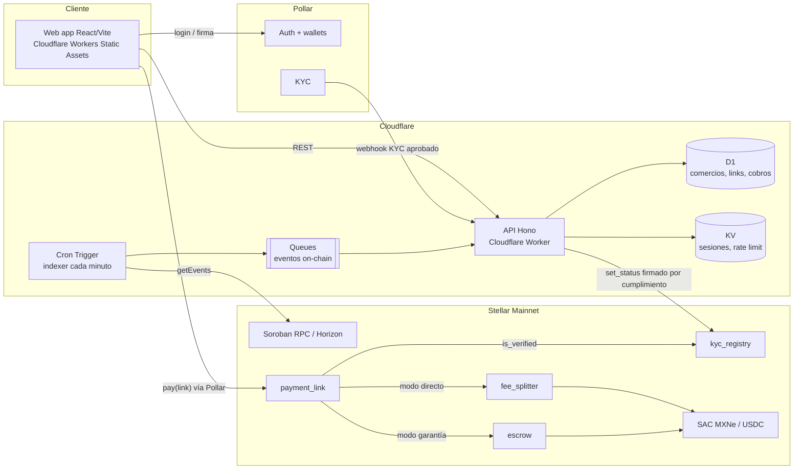
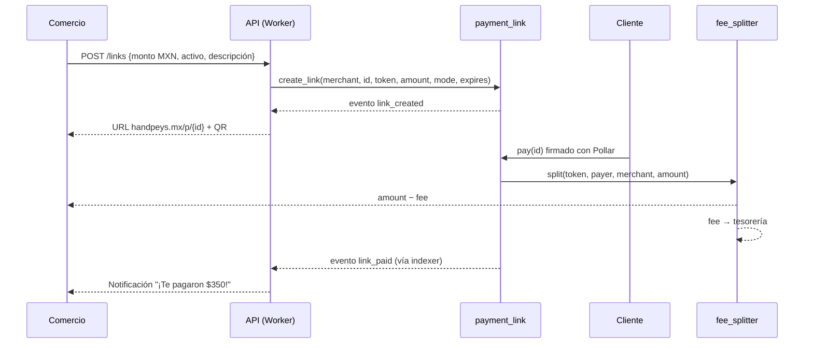

# Hand Peys 🇲🇽

> **Cobra con un link. Recibe pesos digitales. Sin terminal, sin comisiones abusivas.**
> Links y QR de cobro en **MXNe** y **USDC** sobre **Stellar**, con KYC de **Pollar** y contratos **Soroban**.

Documento maestro del proyecto para el **Ship It: Builder Challenge (BAF × Stellar México)**, del 23 al 27 de noviembre de 2026.
Repositorio: `DonCervantes/hand-peys` · Lanzamiento en **mainnet: viernes 27 de noviembre de 2026**.

---

## 0. Estado de este documento

| Decisión | Valor | Estado |
|---|---|---|
| Producto central | Links/QR de cobro para changarros, freelancers y PyMEs | ✅ Decidido |
| Activos | MXNe (Etherfuse) + USDC (Circle), mainnet | ✅ Decidido. ⚠️ Falta verificar los emisores oficiales |
| Código base | Repo limpio (monorepo) que reusa piezas de `handle-pay` y `Linkpay` | ✅ Decidido |
| Wallet / login / KYC | Pollar (`@pollar/core`, `@pollar/react`) | ⚠️ Faltan los docs del módulo de KYC de Pollar |
| Contratos | `kyc_registry`, `payment_link`, `fee_splitter`, `escrow` | ✅ Decidido |
| Modelo de negocio | Comisión por cobro pagado (hipótesis: 0.9%) | ✅ Decidido. El % se puede ajustar |
| Deploy | Cloudflare (Workers + D1 + KV + Queues + Cron) | ✅ Decidido |
| Repo y fondos mainnet | Daniel creó `DonCervantes/hand-peys` (lo vacía él) y fondea la cuenta deployer | ✅ Decidido |
| Hosting | `hand-peys.cruzcervantesdanieladrianelias.workers.dev` (sin dominio propio) | ✅ Decidido |
| Equipo | Daniel solo. 🙋 = ticket con paso manual suyo | ✅ Decidido |
| Cierre Ship It | Se asume **viernes 27 a las 18:00 CDMX**. Mainnet en vivo antes de las **13:00** | ✅ Supuesto |
| Pollar Live | Requiere una solicitud aprobada por Pollar. Plan B: mainnet con Freighter y KYC en testnet | ⚠️ Riesgo |

---

## 1. Narrativa (100% México)

**Doña Lupe vende tamales en Coyoacán.** Cuando le piden “¿aceptas tarjeta?”, pierde la venta o paga cerca del 3.5% más IVA por la terminal, y además espera días a que le depositen. **Beto, diseñador freelance en Guadalajara**, cobra a sus clientes con transferencias que luego tiene que conciliar a mano por WhatsApp.

**Hand Peys** le da a cada uno un link y un QR de cobro:
1. Escribe el monto en pesos, por ejemplo `$350 MXN – 10 tamales`.
2. Comparte el link por WhatsApp o imprime el QR.
3. El cliente paga en segundos desde su wallet Pollar (entra con Google o con su correo, sin frases semilla).
4. El dinero llega **en segundos** como MXNe (pesos on-chain) o USDC, y Hand Peys retiene solo **0.9%**.
5. Para ventas por encargo existe el modo **“Con garantía”**: el dinero queda en escrow hasta que el cliente confirma la entrega.

**Tono:** cercano y chilango-neutral. Usamos “cobra”, “changarro”, “lana” y “al chile, sin letras chiquitas”. Lo cripto queda invisible: el usuario nunca lee “blockchain” en la app, solo “pesos digitales”. La parte técnica se explica en la sección *“¿Cómo funciona?”* para quien la busque.

---

## 2. Roles

| Rol | Quién es | Puede |
|---|---|---|
| `super_admin` | Equipo Hand Peys | Configurar la comisión (`fee_bps`), la tesorería, pausar contratos, ver métricas globales |
| `cumplimiento` | Oficial de cumplimiento | Revisar los KYC de Pollar, aprobar/rechazar/suspender comercios, escribir en `kyc_registry`, resolver disputas de escrow |
| `comercio_owner` | Dueño del changarro/freelance (con KYC aprobado) | Crear links/QR, ver cobros, reembolsar, invitar colaboradores, retirar fondos |
| `comercio_cajero` | Empleado del comercio | Crear links/QR y ver cobros del día. No puede reembolsar ni retirar |
| `cliente` | Quien paga | Pagar un link (login con Pollar), confirmar entrega o abrir disputa en el modo con garantía, descargar su comprobante |

Regla de oro: **un comercio solo puede crear links si `kyc_registry.is_verified(owner) == true`**. Esto se valida on-chain en `payment_link.create_link`, no solo en el backend.

---

## 3. Arquitectura



### Flujo de cobro (modo directo)


### Monorepo
```
hand-peys/
├─ apps/
│  ├─ web/            # React + Vite + Tailwind + shadcn/ui (landing, app del comercio, checkout)
│  └─ api/            # Hono en Cloudflare Workers, D1 con Drizzle, webhooks de Pollar, indexer
├─ contracts/         # Workspace Rust/Soroban
│  ├─ kyc_registry/
│  ├─ payment_link/
│  ├─ fee_splitter/
│  └─ escrow/
├─ packages/
│  ├─ shared/         # tipos, validaciones zod, formato MXN
│  └─ stellar/        # bindings TS generados de los contratos y helpers
├─ docs/              # PRD.md, TDR.md, PITCH.md, BUSINESS.md, DEMO.md, adr/
├─ scripts/           # deploy de contratos, seeds, smoke tests
└─ .github/workflows/ # CI: cargo test, vitest, playwright, deploy
```

---

## 4. Contratos Soroban

| Contrato | Funciones clave | Eventos | Notas |
|---|---|---|---|
| `kyc_registry` | `init(admin)`, `set_status(addr, level, expires_at)` *(solo cumplimiento)*, `revoke(addr)`, `is_verified(addr) -> bool`, `get(addr)` | `kyc_set`, `kyc_revoked` | **No guarda datos personales**, solo el nivel (`0` nada, `1` básico, `2` completo), la expiración y el hash de la referencia de Pollar |
| `fee_splitter` | `init(admin, treasury, fee_bps)`, `set_fee(bps)` *(máx. 300)*, `split(token, from, to, amount)` | `fee_charged` | Redondeo a favor del comercio. `fee_bps` inicial = 90 |
| `payment_link` | `create_link(merchant, id, token, amount, mode, expires_at)`, `pay(id, payer)`, `cancel(id)`, `get(id)` | `link_created`, `link_paid`, `link_cancelled` | Verifica KYC (llamada cross-contract), una sola vez por link, controla la expiración y la whitelist de tokens (MXNe y USDC) |
| `escrow` | `hold(id, payer, merchant, token, amount, release_after)`, `confirm(id)` *(cliente)*, `refund(id)` *(comercio)*, `dispute(id)`, `resolve(id, to_merchant: bool)` *(cumplimiento)*, `claim(id)` *(comercio, después de `release_after`)* | `held`, `released`, `refunded`, `disputed`, `resolved` | La comisión se cobra solo al liberar, no al reembolsar |

Comunes a todos: `pause()/unpause()` (super_admin), `upgrade(wasm_hash)` (super_admin), `require_auth` en cada acción, sin `unwrap` en las rutas de usuario y errores tipados (`#[contracterror]`).

---

## 5. Stack y deploy en Cloudflare

| Capa | Tecnología |
|---|---|
| Frontend | React 19 + Vite + TypeScript + Tailwind + shadcn/ui + TanStack Router + `@pollar/react` |
| API | Hono en Cloudflare Workers + Drizzle ORM + zod |
| Base de datos | Cloudflare D1 (SQLite) |
| Caché / sesiones / rate limit | Cloudflare KV |
| Eventos | Cron Trigger (cada minuto) → Soroban RPC `getEvents` → Cloudflare Queues → consumer |
| Archivos (comprobantes PDF) | Cloudflare R2 |
| Contratos | Rust + `soroban-sdk`, Stellar CLI para build/deploy y para generar los bindings TS |
| Wallet + KYC | Pollar |
| CI/CD | GitHub Actions + `wrangler deploy` |
| Observabilidad | Workers Logs + Analytics Engine (métricas de cobros) |

Entornos: `local` (wrangler dev + Stellar quickstart), `testnet` (`testnet.handpeys…`) y `mainnet` (dominio principal).
Secretos (`wrangler secret`): `POLLAR_SECRET`, `POLLAR_WEBHOOK_SECRET`, `COMPLIANCE_SIGNER_SECRET` (firma `set_status`; lo ideal es mover esto a firma externa después del hackathon), `SESSION_SECRET`.

---

## 6. KYC con Pollar

Lo que se sabe de Pollar (docs.pollar.xyz, nov 2026):
- El KYC se hace por pasos ordenados y obligatorios. El proveedor de identidad es **Didit** (más pasos de formulario), configurado en *Identity checks* del dashboard. Está disponible en Stellar.
- En el SDK: selección de proveedor, inicio de sesión de KYC y **polling del estado** (`getKycProviders`, `startKyc`, `getKycStatus`, `openKycModal()` / `<KycModal>`). Los nombres exactos se confirman en HP-016 contra el `.d.ts` instalado.
- Los **webhooks de salida todavía están marcados como "upcoming"**, así que no hay que depender de ellos.
- Cada verificación de KYC se cobra en créditos (100 créditos = 1 USD), también en test mode.
- ⚠️ **Live (mainnet) requiere una solicitud desde el dashboard que Pollar tiene que aprobar.** Hay que pedirla lo antes posible.

Flujo propuesto:
1. El comercio se registra con Pollar (Google o correo).
2. Desde el onboarding se abre `<KycModal>` (Didit: identificación + selfie).
3. El front hace polling de `getKycStatus` hasta llegar a un estado final y luego llama a `POST /kyc/sync`. La API **vuelve a consultar el estado en Pollar del lado del servidor** con la secret key, sin confiar en lo que reporta el cliente.
4. Si el estado es aprobado, la API lo guarda en D1 y la cuenta `cumplimiento` firma `kyc_registry.set_status(owner, level, expires)`. Un Cron reconcilia los KYC pendientes cada 5 minutos.
5. Si `level >= 1`, el comercio ya puede cobrar. Hay límites por nivel: nivel 1 hasta $X MXN al mes, nivel 2 sin límite operativo.
6. Al cliente que paga no se le exige KYC en el MVP (pagos menores a un umbral). Queda como bandera configurable.

---

## 7. Pruebas

| Tipo | Herramienta | Qué cubre |
|---|---|---|
| Unitarias de contratos | `cargo test` + `soroban-sdk` testutils | Cada función, auth, errores, expiración, doble pago, redondeo de la comisión, límites de `fee_bps` |
| Integración de contratos | `cargo test` con los 4 contratos y SAC mock | `create_link` sin KYC falla; pago directo con split correcto; escrow confirm/refund/dispute/claim |
| API | Vitest + Miniflare | Endpoints, roles/permisos, firma del webhook de Pollar, idempotencia del indexer |
| E2E | Playwright | Landing → registro → KYC (mock) → crear link → pagar (testnet) → ver cobro |
| Smoke testnet | `scripts/smoke-testnet.mjs` | Deploy completo y un cobro real en testnet |
| Smoke mainnet | `scripts/smoke-mainnet.mjs` | Un cobro de **$10 MXN en MXNe** y uno de **1 USDC**, con verificación del hash en el explorer |
| Seguridad | Checklist manual + `cargo clippy` + `npm audit` | Auth en todos los métodos, ningún secreto en el bundle, rate limit, CORS, CSP |

---

## 8. Modelo de negocio (hipótesis a validar)

- **0.9% por cobro pagado**, sin renta, sin terminal y sin plazo forzoso. El escrow tiene el mismo costo; el reembolso es gratis.
- Futuro: plan **Pro** (multi-sucursal, API, facturación CFDI), un spread pequeño en on/off-ramp MXN↔MXNe con un socio y créditos para comercios basados en su historial de cobros.
- Mercado: millones de micronegocios en México que operan principalmente en efectivo (dato a citar con fuente INEGI en BUSINESS.md).
- Comparativa a documentar con fuentes: terminales (Clip, Mercado Pago Point), CoDi/DiMo y transferencia SPEI.

---

## 9. Plan día a día (tickets → 1 commit cada uno)

Convención: `HP-XXX`, rama `main` y commit `feat(HP-XXX): …`. Cada ticket debe agregar código o docs reales, porque los commits vacíos no puntúan.

### Miércoles 25 · Misión “En el aire” · Base + contratos
| Ticket | Descripción |
|---|---|
| HP-001 | Scaffold del monorepo (pnpm workspaces), README, LICENSE, `.editorconfig` |
| HP-002 | `docs/PRD.md` |
| HP-003 | `docs/TDR.md` (decisiones técnicas + ADRs) |
| HP-004 | Workspace Rust `contracts/` + CI `cargo test` |
| HP-005 | `kyc_registry`: storage, `set_status`, `is_verified`, errores |
| HP-006 | Tests de `kyc_registry` |
| HP-007 | `fee_splitter`: `init`, `set_fee`, `split` |
| HP-008 | Tests de `fee_splitter` (redondeo, límites) |
| HP-009 | `payment_link`: `create_link`, `pay`, `cancel` + llamada cross-contract a KYC |
| HP-010 | Tests de `payment_link` |
| HP-011 | `escrow`: hold/confirm/refund/dispute/resolve/claim |
| HP-012 | Tests de `escrow` + integración de los 4 contratos |
| HP-013 | `scripts/deploy-contracts.mjs` (testnet) + bindings TS en `packages/stellar` |
| HP-014 | Deploy a testnet y guardar los contract IDs en `deployments/testnet.json` |
| HP-015 | `apps/api`: Hono + wrangler + D1 + esquema Drizzle (comercios, usuarios, roles, links, cobros, kyc) |
| HP-016 | Auth con Pollar (validar sesión) + middleware de roles |
| HP-017 | Endpoints de links (CRUD) + QR |
| HP-018 | Webhook de KYC de Pollar → D1 → `set_status` |
| HP-019 | Indexer: Cron + Queues + consumer idempotente |
| HP-020 | `docs/architecture.md` con los diagramas Mermaid |

### Jueves 26 · Misión “Demo” + reto express · Producto visible
| Ticket | Descripción |
|---|---|
| HP-021 | `apps/web` scaffold + design system (colores, tipografía, tono MX) |
| HP-022 | Landing: hero, cómo funciona, comparativa de comisiones, FAQ, CTA |
| HP-023 | Landing: sección para changarros/freelancers + testimonios ilustrativos (marcados como ejemplo) |
| HP-024 | Onboarding: login con Pollar + flujo de KYC |
| HP-025 | Dashboard del comercio: saldo, cobros, links activos |
| HP-026 | Crear link/QR (monto en MXN, activo, modo directo o con garantía) |
| HP-027 | Checkout público `/p/:id` con pago vía Pollar |
| HP-028 | Estado del cobro en vivo + comprobante (R2/PDF) |
| HP-029 | Escrow en la UI: confirmar entrega, reembolsar, disputar |
| HP-030 | Panel de `cumplimiento` (KYC y disputas) |
| HP-031 | Panel de `super_admin` (comisión, pausa, métricas) |
| HP-032 | Gestión de colaboradores (`comercio_cajero`) |
| HP-033 | Tests de API (Vitest) |
| HP-034 | Tests E2E (Playwright) en testnet |
| HP-035 | Deploy de web + API en Cloudflare (testnet) + CI de deploy |
| HP-036 | 🙋 `docs/DEMO.md`: guion del video de 2 min + grabación |
| HP-037 | `docs/BUSINESS.md`: modelo, mercado, competencia (con fuentes) |

### Viernes 27 · Misión “Ship it” · Mainnet 🚀
| Ticket | Descripción |
|---|---|
| HP-038 | Verificar los emisores oficiales de MXNe y USDC en mainnet + config por red |
| HP-039 | Checklist de seguridad + `clippy` + revisión de auth |
| HP-040 | 🙋 Deploy de contratos a **mainnet** (Daniel firma, antes de las 12:00) → `deployments/mainnet.json` |
| HP-041 | Configurar la API/web de producción con los IDs de mainnet + secretos |
| HP-042 | Smoke en mainnet: cobro de $10 MXNe + 1 USDC, con los hashes en el README |
| HP-043 | `docs/PITCH.md` + deck |
| HP-044 | README final: links en vivo, contratos, cómo correrlo, demo |
| HP-045 | Post de lanzamiento (para la misión de compartir) + changelog |

---

## 10. Pitch (estructura de 3 min)

1. **Gancho (15 s):** “Doña Lupe pierde 1 de cada 5 ventas por no aceptar tarjeta.” *(cifra a respaldar o reemplazar)*
2. **Problema (30 s):** terminales caras, depósitos lentos, efectivo inseguro, conciliación a mano.
3. **Solución (30 s):** Hand Peys: un link, pesos digitales, 0.9% y dinero en segundos.
4. **Demo (60 s):** crear link → pagar con Google vía Pollar → ver el cobro → hash en mainnet.
5. **Por qué Stellar (15 s):** comisiones de fracción de centavo, MXNe, liquidación en ~5 s.
6. **Modelo + mercado (20 s).**
7. **Cierre (10 s):** “Ya está en mainnet. Cobra con Hand Peys hoy.”

---

## 11. Futuros features

Backlog fuera del alcance del hackathon, inspirado en AllScale (Asia) y adaptado a México. Cada feature está detallada (historia, solución, capas técnicas, criterios de aceptación y riesgos) en **`FUTUROS-FEATURES.md`** (`docs/` en el repo).

- **P0 (dic 2026):** PWA + push, QR fijo de monto abierto, Tiendita por WhatsApp, asistente de IA, salida a tu banco por SPEI.
- **P1 (Q1 2027):** CFDI 4.0, split entre socios, suscripciones, cobros a clientes en EE.UU., apartado con garantía, nómina, bot de WhatsApp, API pública.
- **P2 (visión):** tandas digitales, CETES tokenizados, crédito para changarros, pagos de agentes de IA (x402), marca blanca.

## 12. Pendientes para arrancar

- [ ] 🙋 Vaciar `DonCervantes/hand-peys` (trae el import de handle-pay).
- [ ] 🙋 Dar acceso de escritura a la GitHub App de Claude sobre `hand-peys`.
- [ ] 🙋 Crear la app en el dashboard de Pollar (test mode), configurar Didit en *Identity checks* y **pedir el acceso Live hoy**.
- [ ] 🙋 Fondear con XLM la cuenta deployer de mainnet antes del viernes por la mañana.
