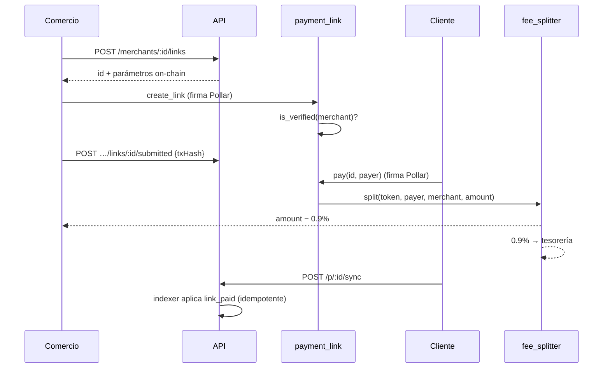
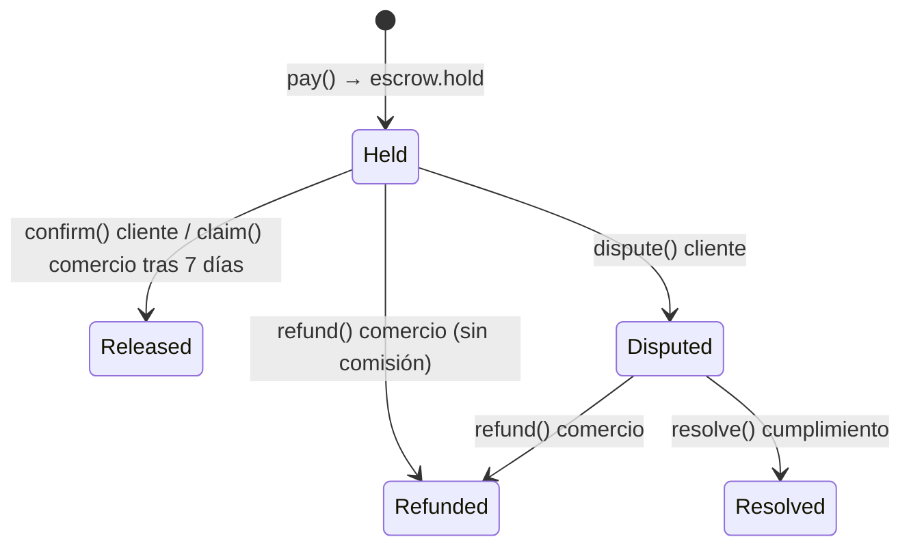

# Arquitectura

```mermaid
flowchart LR
  subgraph Navegador
    W[Web React/Vite<br/>Workers Static Assets]
    P[@pollar/react<br/>login · wallet · KYC]
  end
  subgraph Cloudflare Worker hand-peys
    API[API Hono /api/*]
    D1[(D1)]
    KV[(KV<br/>retos · cursor · rate limit)]
    CRON[Cron cada minuto]
    Q[[Queue opcional]]
  end
  subgraph Stellar
    RPC[Soroban RPC]
    KYC[kyc_registry]
    PL[payment_link]
    FS[fee_splitter]
    ES[escrow]
    SAC[SAC MXNe / USDC]
  end

  W --> P
  W -- reto SEP-53 / REST --> API
  API --> D1
  API --> KV
  API -- set_status (cumplimiento) --> KYC
  W -- create_link / pay firmados con Pollar --> PL
  PL -- is_verified --> KYC
  PL -- directo --> FS --> SAC
  PL -- garantía --> ES --> SAC
  ES -. get_config .-> FS
  CRON -- getEvents --> RPC
  CRON --> Q --> API
```

## Cobro directo



## Modo con garantía



## Modelo de datos (D1)
`users` · `merchants` (estado KYC espejo del on-chain) · `memberships` (owner/cajero) · `invitations` · `links` · `payments` · `chain_events` (idempotencia) · `kyc_reviews` · `settings`. Ver `apps/api/migrations/0001_init.sql`.
